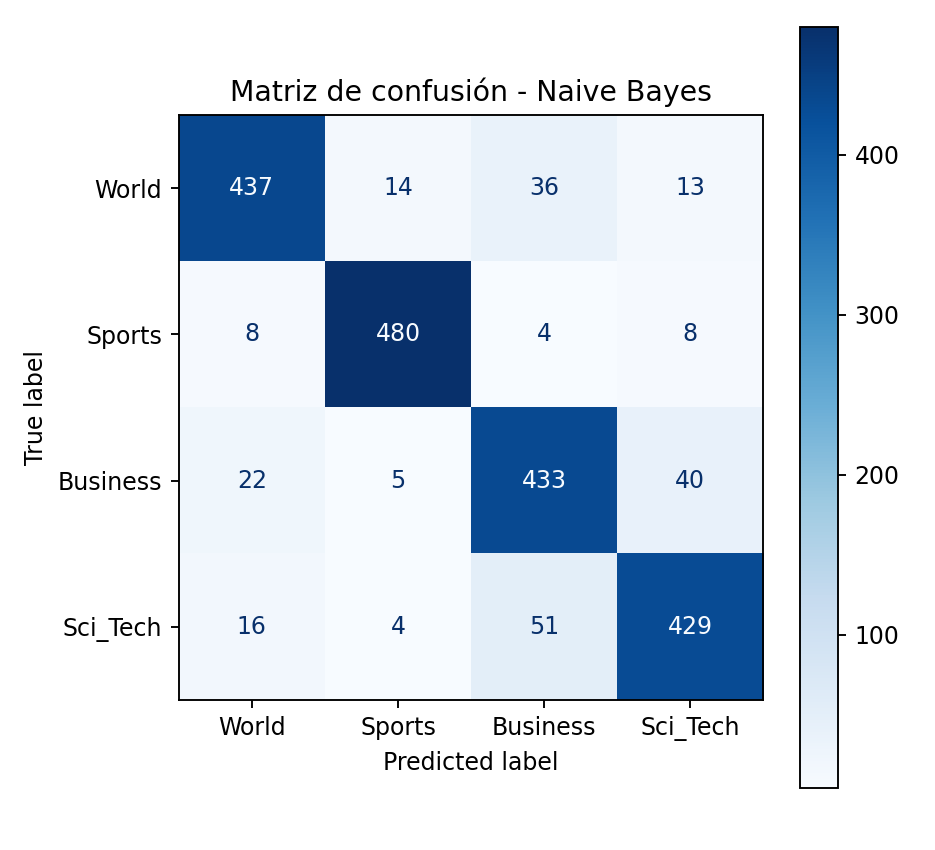

# Clasificador de noticias AG News con TF-IDF

Pre-entrega Módulo 3 · Autor: Luque Vicleniz

Pipeline de clasificación supervisada que lleva el texto crudo de una noticia a una categoría (`World`, `Sports`, `Business`, `Sci_Tech`) usando vectorización TF-IDF y un clasificador clásico de scikit-learn.

## Archivos

| Archivo | Contenido |
|---|---|
| `Clasificador_TFIDF_LuqueVicleniz.ipynb` | Notebook con el pipeline completo, comentado |
| `requirements.txt` | Versiones de las librerías utilizadas |
| `experimentos_tfidf.csv` | Resultados de la búsqueda de `max_features` y `ngram_range` |
| `comparacion_modelos.csv` | Comparación de los tres clasificadores |
| `experimento_stopwords.csv` | Efecto de filtrar stop-words |
| `matriz_confusion_nb.png` | Matriz de confusión del modelo final |

## Datos

Se usa el mismo corpus que en el Módulo 2: AG News, con los splits provistos por la cátedra: `ag_news_train.csv` (8.000 noticias) y `ag_news_test.csv` (2.000). Las cuatro clases están perfectamente balanceadas (2.000 por clase en train y 500 en test), por lo que accuracy y F1-macro resultan casi equivalentes.

## Preprocesamiento

Se reutiliza el pipeline del Módulo 2, aplicado con las mismas reglas a train y test:

1. Decodificación de entidades HTML rotas (`#39;`, `quot;`) y eliminación de tags.
2. Eliminación de URLs, dominios, firmas de agencia (AP, Reuters) y texto bursátil repetido.
3. Normalización: minúsculas, remoción de dígitos y puntuación, conservando las negaciones.
4. Lematización con SpaCy (`en_core_web_sm`).

Estas reglas son fijas y no aprenden nada de los datos, por lo que aplicarlas al test no genera fuga de información.

## Vectorización: parámetros y justificación

Se usó `TfidfVectorizer(max_features=10000, ngram_range=(1, 1))`.

Para elegir los parámetros se probaron 8 combinaciones con **validación cruzada de 3 pedazos sobre el train** (Regresión Logística, F1-macro). El test no intervino en la decisión.

| max_features | ngram_range | F1-macro (CV) |
|---|---|---|
| 10000 | (1, 1) | **0,8765** |
| sin límite | (1, 1) | 0,8760 |
| 5000 | (1, 1) | 0,8744 |
| 10000 | (1, 2) | 0,8737 |
| 5000 | (1, 2) | 0,8709 |
| sin límite | (1, 2) | 0,8704 |
| 2000 | (1, 1) | 0,8661 |
| 2000 | (1, 2) | 0,8567 |

- **Los bi-gramas no mejoraron** el resultado: en los cuatro pares comparados, las palabras sueltas empatan o ganan. Una explicación probable (no verificada) es que las noticias son muy cortas (mediana de 35 tokens) y los bi-gramas agregan muchas columnas poco repetidas.
- **`max_features=10000`** rinde igual que el vocabulario completo (17.025 palabras) con un 41% menos de columnas, lo que reduce el uso de memoria y el riesgo de sobreajuste. Las diferencias entre las tres primeras configuraciones están dentro del margen de ruido, y por eso se eligió la más liviana.

### Stop-words

La consigna advierte sobre no filtrar stop-words ruidosas, por lo que se midió su efecto. Se probó filtrar la lista de scikit-learn conservando las negaciones (`no`, `not`, `nor`, `never`, `none`, `cannot`, `nothing`, `neither`, `nobody`, `nowhere`), que cambian el sentido de una frase. La comparación usó validación cruzada de 3 pedazos sobre el train, con `max_features=10000` y unigramas:

| Modelo | Sin filtrar | Stop-words filtradas |
|---|---|---|
| Naive Bayes | 0,8849 | 0,8847 |
| Regresión Logística | 0,8765 | 0,8792 |

El filtro no cambia el resultado de Naive Bayes y mejora 0,27 puntos a la Regresión Logística, una diferencia dentro del margen de ruido. Además, solo elimina 253 de las 17.025 palabras del vocabulario (1,5%): el resto son palabras que no están en esa lista, por lo que la matriz es grande por la cantidad de palabras de contenido y no por las stop-words. Lo que realmente la reduce es `max_features=10000`. Por eso se mantuvo la configuración sin filtrar, y TF-IDF se encarga de bajarles el peso a las palabras muy comunes.

## Elección del modelo

Comparé tres clasificadores clásicos (Regresión Logística, SVM lineal y Naive Bayes multinomial) con la misma configuración de TF-IDF: un máximo de 10.000 palabras y solo palabras sueltas. Usé validación cruzada de 3 pedazos sobre el train, así pude compararlos sin mirar el test.

| Modelo | F1-macro (validación cruzada) |
|---|---|
| **Naive Bayes** | **0,8849** |
| Regresión Logística | 0,8765 |
| SVM lineal | 0,8755 |

Naive Bayes obtuvo el mejor resultado, y la Regresión Logística y la SVM quedaron prácticamente empatadas. Elegí Naive Bayes por ese resultado y porque además es el más simple y rápido de entrenar. Mi hipótesis, que no verifiqué, es que con solo 8.000 noticias cortas un modelo con pocos parámetros sobreajusta menos que uno más flexible.

Recién después de elegir usé el test, una sola vez, para confirmar. Naive Bayes llegó a 0,8895 de accuracy y 0,8897 de F1-macro, contra 0,883 y 0,8827 de la Regresión Logística. La diferencia es chica (13 noticias de 2.000), pero apareció tanto en la validación cruzada como en el test.

## Resultados en el test (Naive Bayes)

| Clase | Precision | Recall | F1 |
|---|---|---|---|
| World | 0,905 | 0,874 | 0,889 |
| Sports | 0,954 | 0,960 | 0,957 |
| Business | 0,826 | 0,866 | 0,846 |
| Sci_Tech | 0,876 | 0,858 | 0,867 |
| **Macro avg** | 0,890 | 0,890 | **0,890** |

Accuracy global: **0,8895**.



## Análisis preliminar de errores

El modelo final se equivoca en 221 de las 2.000 noticias del test. Según la matriz de confusión:

- **Sports es la categoría más fácil** de predecir (F1 de 0,957), porque usa un vocabulario muy propio: equipos, torneos y jugadores.
- **Business es la más difícil** (F1 de 0,846). Además tiene la precision más baja (0,826): el modelo la usa como categoría "refugio" cuando una noticia es dudosa.
- **La confusión más fuerte es entre Business y Sci_Tech**: 40 noticias de Business se predijeron como Sci_Tech y 51 al revés. Son 91 errores, el 41% del total. Le sigue la confusión entre World y Business (36 y 22 noticias).

Para entender por qué, leí ejemplos de errores. Noticias etiquetadas como Business, como *"Symantec Said to Be in Talks for Veritas"* o *"AOL Is Said to Plan 700 Layoffs"*, hablan de empresas de tecnología haciendo operaciones de negocios. Y una noticia etiquetada como Sci_Tech, *"E.U. Regulators Approve Oracle's PeopleSoft Bid"*, trata una adquisición. TF-IDF cuenta palabras sueltas y no entiende el contexto, así que el vocabulario de empresas y el de tecnología se mezcla. Algunas noticias son ambiguas incluso para una persona, y alguna etiqueta del corpus resulta discutible.

Esto muestra el límite de este enfoque. Un modelo que capture el contexto, como los del Módulo 4, podría ayudar en estas categorías vecinas.

## Calidad del baseline

Con 4 clases balanceadas, un modelo que adivinara al azar acertaría cerca del 25%. El baseline (TF-IDF con parámetros por defecto y Regresión Logística) alcanza accuracy 0,8835 y F1-macro 0,8832, y el modelo final (Naive Bayes) llega a 0,8895 y 0,8897. Los resultados tienen sentido para el problema: están muy por encima del azar y cerca de la referencia de la cátedra para AG News (F1-macro ≈ 0,90 con Regresión Logística), un poco por debajo. Una posible causa, que no se verificó en este notebook, es que la limpieza y la lematización descartan información (mayúsculas, números, formas verbales) que a un modelo clásico le puede servir.

## Cómo reproducirlo

1. Clonar el repositorio y entrar a la carpeta: `git clone <URL-DEL-REPOSITORIO>` y `cd <nombre-del-repositorio>`
2. Instalar las dependencias: `pip install -r requirements.txt`
3. Descargar el modelo de SpaCy: `python -m spacy download en_core_web_sm` (versión usada: 3.8.0)
4. Abrir el notebook desde esa carpeta y ejecutarlo de arriba hacia abajo. El notebook busca `cargar_dataset.py` y la carpeta `ag_news/` en la carpeta actual.

En Google Colab: ejecutar `!git clone <URL-DEL-REPOSITORIO>` y `%cd <nombre-del-repositorio>` en una celda, y luego abrir y correr el notebook desde esa carpeta.

## Rigor estadístico

- Se usan los splits train/test provistos; el test nunca se usa para entrenar ni para decidir.
- `TfidfVectorizer` se ajusta solo con el train. Dentro de la validación cruzada y del modelo final se usa un `Pipeline`, que reajusta el vectorizador en cada pedazo y evita la fuga de datos.

## Versiones de las librerías

Las versiones usadas están en `requirements.txt`:

```
pandas==2.2.3
numpy==2.4.6
scikit-learn==1.6.1
matplotlib==3.10.0
spacy==3.8.18
```

El modelo de lenguaje `en_core_web_sm` (3.8.0) se instala aparte con el comando de la sección anterior.

## Fuentes y licencia de los datos

- **AG News:** corpus de AG (Antonio Gulli), de uso académico estándar (Zhang et al., 2015). La muestra balanceada y recortada que se usa acá fue preparada por la cátedra del programa.
- Los datos se incluyen solo con fines educativos, tal como los distribuye la cátedra. Quien reutilice este trabajo debería citar las fuentes originales.
